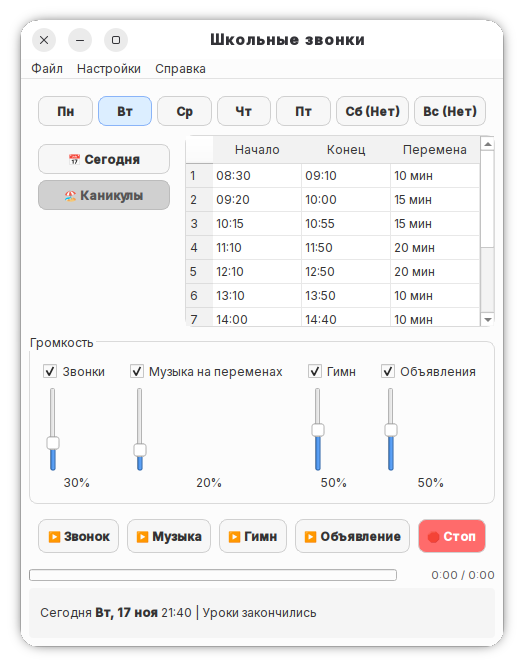

# School Bell

School Bell — настольное приложение для автоматизации школьных звонков. Оно
показывает расписание, подаёт звонки на урок и с урока, включает музыку на
переменах, гимн и объявления, помогает вести расписание и учитывать каникулы.

Программа рассчитана на школу, в которой один компьютер отвечает за звонки:
рабочее место дежурного, кабинет администратора или отдельный компьютер у
ресепшн. Основные сценарии:

- автоматическая подача звонков по обычному или сокращённому расписанию;
- музыкальное сопровождение перемен;
- гимн и объявления в заданное время;
- отображение текущего урока или перемены;
- отключение автоматических событий на каникулах;
- ручной запуск звуков и оперативное управление громкостью.

## Интерфейс




## Возможности

### Расписание

- Таблица звонков с временем начала и окончания уроков и длительностью перемен.
- Два шаблона расписания: обычное и сокращённое. Для каждого дня можно выбрать
  один из шаблонов или вариант «нет занятий».
- Редактор дня: добавление, изменение, удаление и сортировка уроков,
  перемещение уроков вверх/вниз, копирование расписания из шаблона или другого
  дня.
- Редактор шаблонов расписания с отдельными вкладками для обычного и
  сокращённого варианта.
- Автоматическое переключение таблицы на текущий день при смене календарной
  даты, в том числе после выхода компьютера из сна.
- Подсветка текущего урока и ближайшего события, обратный отсчёт до звонка в
  заголовке окна и подсказке системного трея.
- Загрузка и сохранение расписания в YAML.

### Звонки

- Автоматический звонок на урок и с урока по расписанию текущего дня.
- Отдельные звуковые файлы для звонка на урок и с урока.
- Отдельная громкость звонков.
- Ручной запуск звонка с главного экрана.
- Защита от повторного срабатывания одного и того же события.

### Музыка на переменах

- Несколько музыкальных папок одновременно; поддерживаются вложенные папки.
- Случайный выбор трека из выбранных файлов.
- Исключение отдельных треков и целых папок с помощью галочек в настройках.
- Настройка задержки запуска музыки после звонка: от 0 до 10 минут.
- Треки не повторяются в течение дня, пока не будут использованы все доступные.
- Отдельная громкость музыки.
- Ручной запуск музыки с главного экрана.
- Отображение текущего трека и прогресс воспроизведения.

### Гимн

- Отдельный аудиофайл гимна.
- Выбор дня недели и времени автоматического воспроизведения.
- Отдельная громкость гимна.
- Ручной запуск гимна с главного экрана.

### Объявления

- Список объявлений с включением и отключением каждого пункта.
- Одноразовые объявления по конкретной дате.
- Повторяющиеся объявления по выбранным дням недели.
- Отображение статуса: ожидает, сыграно, отключено, повторяется, дата прошла.
- Отдельная громкость объявлений.
- Ручной выбор объявления для воспроизведения.

### Режим каникул

- Список периодов каникул с датой начала и окончания; обе граничные даты
  включаются в период.
- Три режима: «Автоматически», «Включить принудительно» и «Выключить
  принудительно».
- Сохранение выбранного режима между запусками.
- Кнопка-индикатор «Каникулы» на главном экране: красная при активном режиме,
  серая при неактивном. Нажатие открывает настройки каникул.
- На каникулах автоматические звонки, гимн, объявления и музыка не запускаются.
- Уже играющая автоматически запущенная музыка останавливается; ручное
  воспроизведение через кнопки и меню остаётся доступным.
- События, пропущенные во время каникул, не запускаются после их окончания.

### Управление и сервис

- Общая полоса прогресса для всех воспроизводимых звуков: звонков, музыки,
  гимна и объявлений. Показывает позицию и длительность, сбрасывается при
  остановке или завершении.
- Четыре независимых регулятора громкости: звонок, музыка, гимн, объявления.
- Кнопки ручного запуска звонка, музыки, гимна и объявления, а также общая
  кнопка остановки.
- Системный трей: «Показать», «Сегодня», «Выход»; при закрытии окна программа
  может остаться в трее.
- Журнал событий за последние дни с фильтром ошибок.
- Экспорт и импорт всех настроек в YAML.
- Автоматическая резервная копия `preferences.yml.bak` перед сохранением
  пользовательских настроек.
- Русский и английский языки основного интерфейса. Часть служебных диалогов
  пока содержит только русские подписи.

## Установка

### Linux: запуск из исходников

Требования: Python 3.10+ (проверено на Python 3.12), PySide6 6 и PyYAML.

```bash
git clone https://github.com/otetswoo/python_schoolbell.git
cd python_schoolbell

python3 -m venv .venv
. .venv/bin/activate
python -m pip install --upgrade pip
python -m pip install PySide6 PyYAML

python school_bell.py
```

В ALT Linux системные пакеты называются `python3-module-pyside6` и
`python3-module-yaml`. В Debian/Ubuntu используются
`python3-pyside6.qtcore`, `python3-pyside6.qtgui`,
`python3-pyside6.qtwidgets`, `python3-pyside6.qtmultimedia` и `python3-yaml`.
После установки системных пакетов виртуальное окружение не обязательно.

### Linux: сборка пакетов

Подробности и требования к инструментам находятся в
[BUILDING.md](BUILDING.md). Кратко:

```bash
# DEB: нужны dpkg-deb и fakeroot
bash build_scripts/build_deb.sh

# RPM: нужен rpmbuild; основной целевой дистрибутив — ALT Linux
bash build_scripts/build_rpm.sh

# AppImage: нужен PyInstaller и appimagetool
bash build_scripts/build_appimage.sh
```

Результаты сборки складываются в `dist/`:

- `SchoolBell_<version>_all.deb`;
- `SchoolBell_<version>_noarch.rpm`;
- `SchoolBell_<version>_x86_64.AppImage`.

DEB и RPM используют системные Python и PySide6 и не включают собственный
Python runtime. После установки пакета приложение запускается из меню
приложений или командой `school-bell`.
AppImage собирается через PyInstaller в режиме `onedir` и включает Python,
PySide6, Qt-плагины и ресурсы приложения. AppImage следует собирать в среде с
достаточно старой glibc, если нужна совместимость со старыми дистрибутивами.

### Windows

Для запуска из исходников на Windows нужны
Python 3.10+ и те же пакеты:

```powershell
python -m pip install PySide6 PyYAML
python school_bell.py
```


## Первый запуск и настройка

После запуска откройте меню «Настройки» и последовательно задайте нужные
параметры:

1. **Мелодии звонков** — выберите файлы звонка на урок и с урока.
2. **Музыка на переменах** — добавьте одну или несколько папок, при
   необходимости снимите галочки с лишних треков и настройте задержку и
   громкость.
3. **Гимн** — выберите файл, день недели, время и громкость.
4. **Объявления** — добавьте одноразовое объявление по дате или повторяющееся
   по дням недели.
5. **График каникул** — добавьте периоды и выберите режим: автоматический,
   принудительно включённый или принудительно выключенный.
6. **Редактировать день** — измените расписание выбранного дня.
7. **Редактор шаблонов** — настройте общие обычное и сокращённое расписания.
8. Не забудьте сохранить расписание через «Файл → Сохранить расписание» или
   `Ctrl+S`.

### Где хранятся настройки

При запуске из каталога проекта настройки и рабочие файлы находятся рядом с
`school_bell.py`:

- `preferences.yml` — пользовательские настройки;
- `schedule.yml` — расписание;
- `music/` — музыка по умолчанию;
- `logs/` — журнал событий.

В установленной версии (DEB, RPM или AppImage) пользовательские данные
хранятся отдельно от программы:

```text
$XDG_DATA_HOME/school-bell/       # если XDG_DATA_HOME задан
~/.local/share/school-bell/       # по умолчанию
```

В этом каталоге создаются `preferences.yml`, `schedule.yml`, `music/` и
`logs/`. Звуки и расписание по умолчанию входят в пакет и не требуют записи в
системные каталоги. При сохранении настроек рядом с `preferences.yml`
создаётся резервная копия `preferences.yml.bak`.

## Использование

Главное окно состоит из нескольких частей:

- **Кнопки дней недели** сверху. Левый клик выбирает день, правый клик
  переключает вариант: обычное расписание → сокращённое → без занятий.
- **Левая панель**: «Сегодня» и кнопка-индикатор «Каникулы».
- **Таблица расписания**: начало урока, конец урока и длительность перемены.
  Текущий урок и ближайший звонок подсвечиваются.
- **Блок громкости**: отдельные ползунки и переключатели автозапуска для
  звонков, музыки, гимна и объявлений.
- **Нижние кнопки**: ручной звонок, музыка, гимн, объявление и общая остановка.
- **Строка текущего трека** (для музыки на перемене) **и полоса прогресса**
  (для любого воспроизводимого звука).
- **Строка состояния** — текущая дата, урок или перемена, служебные сообщения.

Типовые действия:

- чтобы изменить расписание, выберите день и откройте «Настройки →
  Редактировать день»;
- чтобы поменять общий шаблон, используйте «Настройки → Редактор шаблонов»;
- чтобы проверить звук, нажмите соответствующую кнопку в нижней части окна;
- чтобы остановить любой звук, нажмите «Стоп»;
- чтобы свернуть программу в трей, закройте окно и выберите «Остаться в трее».

### Горячие клавиши

| Клавиша | Действие |
|---|---|
| `Ctrl+O` | Загрузить расписание |
| `Ctrl+S` | Сохранить расписание |
| `Ctrl+E` | Экспорт всех настроек |
| `Ctrl+I` | Импорт всех настроек |
| `Ctrl+T` | Перейти к текущему дню |
| `Ctrl+Q` | Выход |

## Автозапуск и защита рабочего места

Для школьного компьютера программу удобно добавлять в автозапуск сеанса.
Например, в XFCE4: «Параметры → Сеанс и запуск → Автозапуск приложений».
Команда запуска зависит от способа установки:

- установленный пакет: `school-bell`;
- запуск из исходников: `python3 /путь/к/school_bell.py`.

Пример `~/.config/autostart/school-bell.desktop`:

```ini
[Desktop Entry]
Type=Application
Name=School Bell
Exec=school-bell
Hidden=false
X-GNOME-Autostart-enabled=true
X-GNOME-Autostart-Delay=5
```

Задержка 5 секунд даёт звуковой системе время инициализироваться. Если
компьютер стоит в доступном месте, дополнительно настройте блокировку экрана
средствами рабочего стола и отдельную учётную запись для работы звонков.

## Технологии

- Python 3.10+.
- PySide6 / Qt 6: QtCore, QtGui, QtWidgets.
- Qt Multimedia: `QMediaPlayer` и `QAudioOutput` для всех звуков.
- PyYAML для чтения и записи `schedule.yml` и `preferences.yml`.
- Стандартная библиотека Python для дат, путей, случайного выбора треков и
  журналирования.
- PyInstaller используется для сборки AppImage, а также в существующих
  Windows-сценариях сборки.

## Разработка и сборка

Требования для запуска из исходников: Python 3.10+ и пакеты `PySide6`,
`PyYAML`.

```bash
python3 -m venv .venv
. .venv/bin/activate
python -m pip install PySide6 PyYAML
python school_bell.py
```

Проверка кода и тестов:

```bash
python3 -m compileall -q school_bell.py src tests
python3 -m unittest discover -s tests -v
```

Сборка Linux-пакетов описана в [BUILDING.md](BUILDING.md). Скрипты используют
общие функции из `build_scripts/build_common.sh`, читают версию из
`src/config.py` и не включают пользовательские настройки в пакеты.

## Структура проекта

```text
school_bell.py                 главное окно и логика приложения
src/
  config.py                    версия, пути, значения по умолчанию
  config_manager.py            чтение и запись preferences.yml/schedule.yml
  sound_player.py              общий QMediaPlayer для всех звуков
  music_player.py              выбор треков и музыка на переменах
  volume_control.py            ползунок громкости
  event_logger.py              журнал событий
  gui/localization.py          русские и английские строки интерфейса
  *_dialog.py                  диалоги расписания, музыки, гимна,
                               объявлений и каникул
schedule.yml                   расписание по умолчанию
preferences.yml                локальные настройки при запуске из проекта
sounds/                        звуки звонков
tests/                         точечные тесты логики
build_scripts/                 сборка DEB, RPM, AppImage и Windows-скрипты
BUILDING.md                    инструкции по сборке пакетов
docs/images/screenshot.png     место для нового актуального скриншота
```

